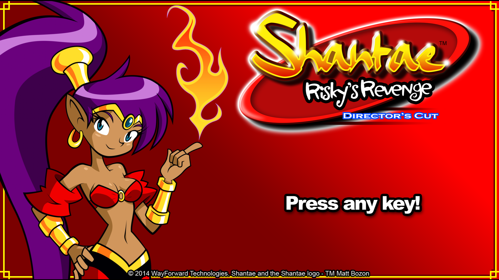
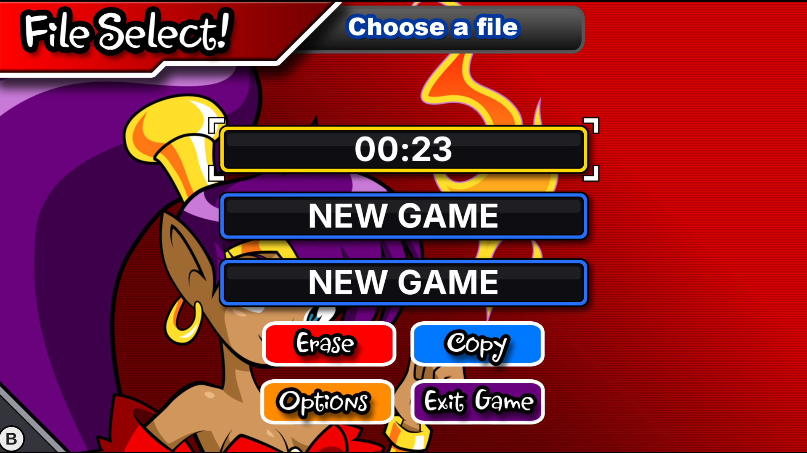
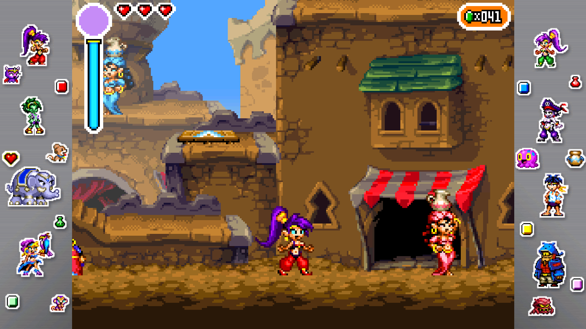
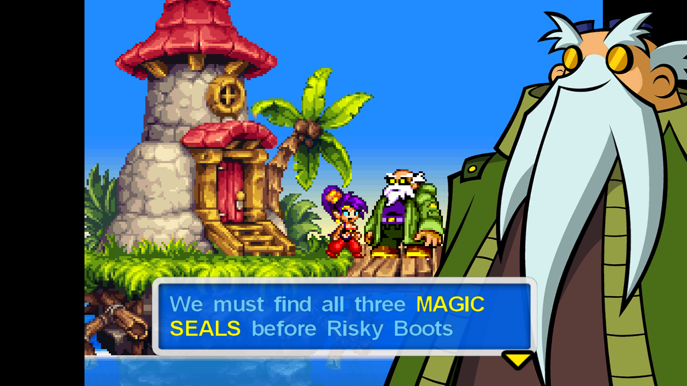
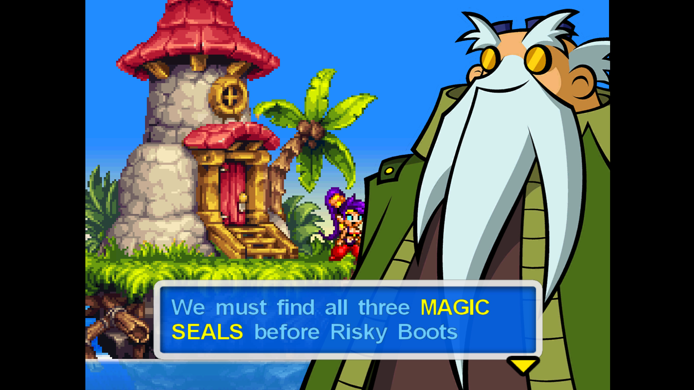
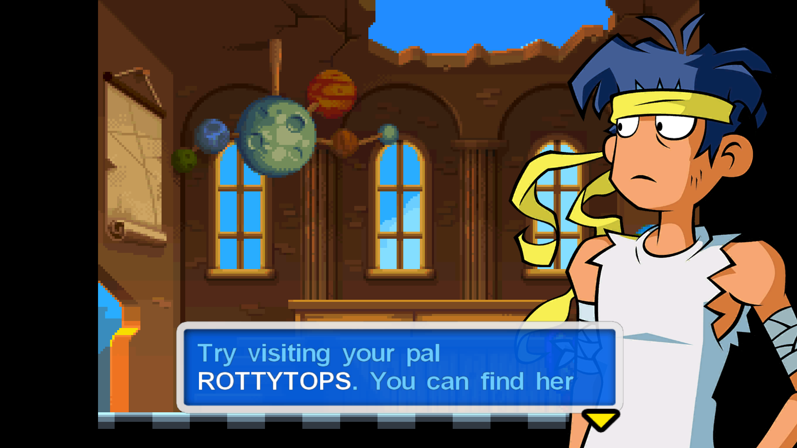
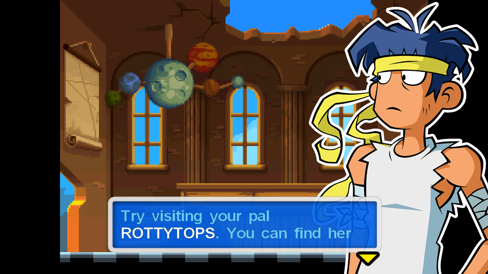
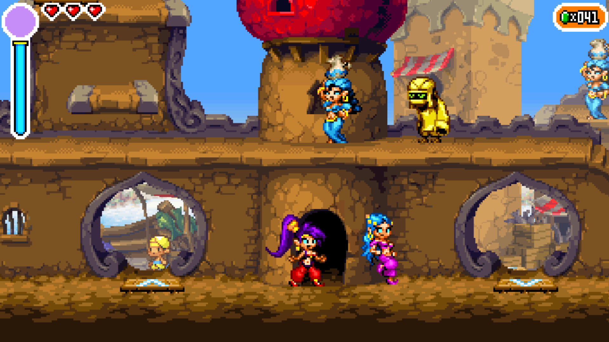
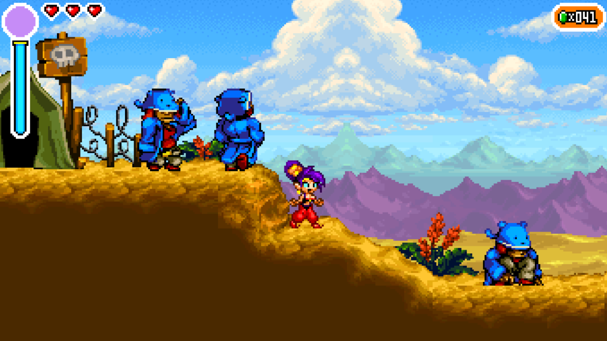

# Shantae Risky's Revenge: Enhanced Mod

A mod for the Steam PC version of *Shantae: Risky's Revenge – Director's Cut* that brings back the DSi look and feel and changes several things with the PC port.

> **AI disclaimer:** This mod heavily uses AI for decompiling, but it does not include any AI-generated images, videos, audio etc. I also didn't originally intend to share this but thought I might as well in case someone wants to use it.

## Features

- DSi-style menus
- 16:9 widescreen support
- Custom borders
- Improved character portraits
- Fixed controller layout
- Adjustable text speed
- Fast-forward
- Debug menu
- And bunch of other smaller fixes/enhancements

## Installation

1. Install [Python](https://www.python.org/downloads/) and tick **"Add python.exe to PATH"** during setup.
2. Download the latest release and extract the `EnhancedMod` folder into the game folder, for example:
   `C:\Program Files (x86)\Steam\steamapps\common\RiskysRevenge\EnhancedMod`
3. Double-click `install.bat`.

All settings are in the game under **Options → Mod Settings**. `uninstall.bat` restores the original game.

The original files are backed up (`.bak`) and the game is always patched from those backups. After a Steam update or "Verify integrity of game files", run `install.bat` again. Your settings are kept.

## Custom border picture

Replace `BorderImages/border.png` with your own 16:9 PNG (for example 1920x1080). Its middle is hidden behind the game. Close the game, run `border.bat`, then choose **Borders: Picture** in Mod Settings.

## Troubleshooting

If the game crashes or something doesn't work, open an issue and attach `executable/rr_mod_log.txt` from the game folder. This will be deeply appreciated!

## Roadmap

- **Widescreen polish:** fix the remaining visual issues in cutscenes and 4:3 rooms. I'm also looking for a pixel artist to help make widescreen feel complete.
- **Randomizer mode**
- **Mod support:** easy custom sprites, custom music and possibly custom levels
- **More languages**
- **Improved speech boxes**
- **Map markers**
- **If you have any suggestions please let me know!** 
## Credits

- File select text font: [Inter](https://rsms.me/inter/) (SIL Open Font License, see `files/fonts`)
- *Shantae: Risky's Revenge* © WayForward. This is an unofficial fan mod and is not affiliated with WayForward. You need your own copy of the game.

## Screenshots

| Title screen | File select |
|---|---|
|  |  |

**Side borders with sprites from the game**

**Better Portraits:** portraits slide in over the black bars so you can see more of the gameplay.

| Better Portraits on | Better Portraits off |
|---|---|
|  |  |

**Portrait outlines**

| Outlines removed | Original outlines |
|---|---|
|  |  |

**Experimental 16:9 widescreen**

|                                             |                                             |
| ------------------------------------------- | ------------------------------------------- |
|  |  |
